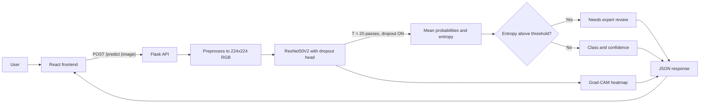

# Failure-Aware Brain Tumor Detection

A deep-learning system that classifies brain MRI slices **and knows when it should not answer**.
It combines a ResNet50V2 classifier, Monte Carlo Dropout uncertainty, and Grad-CAM explanations,
served through a Flask API and a React interface.

> **Educational project. Not a medical device and not for diagnosis.**

<!-- Add a demo GIF or screenshot here:   -->

## Why "failure-aware"?

A normal classifier always returns a label, even when it is wrong. This system runs each image
through the network several times with dropout active (Monte Carlo Dropout). If the passes
disagree, the prediction is flagged **"Low confidence: needs expert review"** instead of being shown as fact.

## Features

- Transfer learning with ResNet50V2 (ImageNet), two-stage training (head, then fine-tune)
- MC Dropout: T = 20 stochastic passes, normalised predictive entropy as the uncertainty score
- Grad-CAM heatmap on the last convolutional feature map
- Uncertainty-aware evaluation: accuracy vs. coverage, uncertainty of correct vs. wrong predictions
- Flask REST API (`/predict`, `/health`) and React UI with a clear low-confidence warning

## Architecture



Full explanation, training flow and code map: [docs/ARCHITECTURE.md](docs/ARCHITECTURE.md)

## Results

> Fill this section with YOUR numbers after running `python -m training.evaluate`.

| Model | Test accuracy | Recall (tumor classes) | Notes |
|---|---|---|---|
| Small CNN baseline | _TBD_ | _TBD_ | trained from scratch |
| ResNet50V2 | _TBD_ | _TBD_ | transfer learning |
| ResNet50V2 + MC Dropout (accepted only) | _TBD_ | _TBD_ | coverage: _TBD_ |

Plots (generated into `results/`): confusion matrix, accuracy vs. coverage, uncertainty histogram.

## Dataset

Use a 4-class brain MRI dataset (glioma, meningioma, pituitary, no tumor), for example the
Kaggle "Brain Tumor MRI Dataset". Arrange it like this:

```
data/
  Training/ glioma/ meningioma/ notumor/ pituitary/
  Testing/  glioma/ meningioma/ notumor/ pituitary/
```

Check for duplicate or near-duplicate images between Training and Testing, because leakage
inflates accuracy. `python -m training.dedupe data/Training` removes exact duplicates only.

## Setup

Requires Python 3.10 to 3.12 and Node.js (LTS).

```bash
python -m venv venv
venv\Scripts\activate            # Windows
# source venv/bin/activate       # macOS / Linux
pip install -r requirements.txt
```

## Train and evaluate

```bash
python -m training.train --data-dir data
python -m training.evaluate --data-dir data
```

Training writes `weights/brain_tumor_model.keras` and `weights/class_names.json`.
Evaluation prints a validation-chosen entropy threshold. Set it before starting the API:

```bash
set ENTROPY_THRESHOLD=0.30       # Windows (use export on macOS / Linux)
```

For a free GPU, train on Google Colab or Kaggle Notebooks and download the two files in `weights/`.

## Run the app

```bash
# terminal 1 (from the repo root)
python -m backend.app

# terminal 2
cd frontend
npm install
npm run dev
```

Open the URL Vite prints (usually http://localhost:5173).

### API

`POST /predict` with form field `image`:

```json
{
  "label": "glioma",
  "confidence": 0.93,
  "uncertainty": 0.21,
  "threshold": 0.35,
  "needs_review": false,
  "probabilities": {"glioma": 0.93, "meningioma": 0.04, "notumor": 0.01, "pituitary": 0.02},
  "heatmap": "<base64 PNG>"
}
```

## Limitations

- Uncertainty from MC Dropout is an approximation and can be poorly calibrated; check the plots.
- Public datasets are small and may contain duplicates or source bias; results may not transfer to real clinical data.
- Grad-CAM shows where the model looked, not proof that the model is right.
- The threshold is a research setting, not a clinical safety limit.

## Related work and inspiration

- Brain-Tumor-Detection-and-Classification-Using-CNN (Raghu20git): EfficientNet-B0 + MC Dropout + Grad-CAM notebook
- Brain-Tumor-Detection (MohamedAliHabib): small CNN baseline and README structure
- Brain-Tumor-Classification-Using-Deep-Learning-Algorithms (SartajBhuvaji): model comparison

## Team

- <YOUR NAME>: <what you built>
- <TEAMMATE>: <what they built>
- Guide: <FACULTY NAME>

## License

MIT, see [LICENSE](LICENSE).
