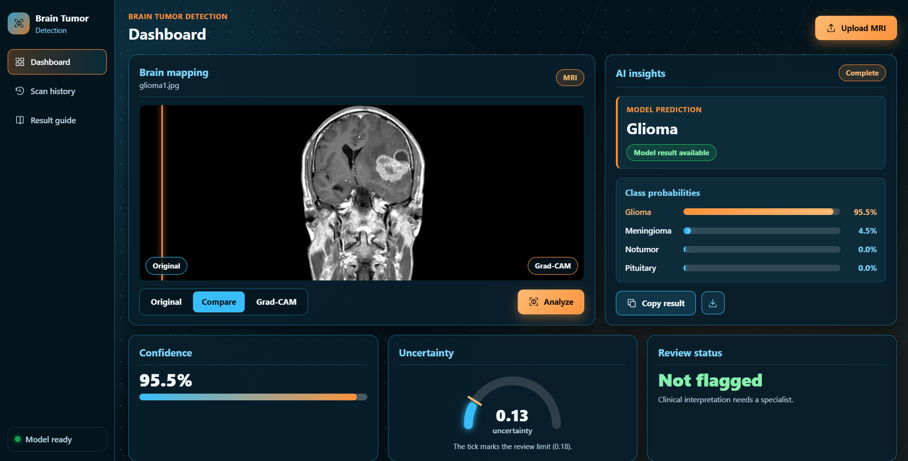

# 🧠 Brain Tumor Detection Using CNN

An AI-powered web application for detecting brain tumors from MRI scans using a Convolutional Neural Network (CNN). This project combines deep learning inference with a Flask backend and a React frontend to provide an interactive interface for image upload, prediction, confidence scores, class probabilities, and uncertainty estimation.

<p align="center">
  
</p>

## Overview

This project classifies brain MRI images into four categories:

- Glioma
- Meningioma
- Pituitary tumor
- No tumor

The goal is to demonstrate how a trained CNN can be integrated into a real-world medical image classification application while also surfacing model uncertainty to help users interpret predictions more carefully.

## Features

- Four-class brain tumor classification
- CNN-based prediction using TensorFlow/Keras
- Easy MRI image upload through a web interface
- Prediction confidence display
- Per-class probability visualization
- Uncertainty estimation using entropy-based filtering
- Flask REST API for model inference
- React dashboard for displaying results
- Responsive UI for desktop and mobile devices
- Heatmap comparison support

## Demo

<video controls width="900">
  <source src="demo/project_demo.mp4" type="video/mp4">
  Your browser does not support the video tag.
</video>

## Tech Stack

| Layer | Technologies |
| --- | --- |
| Deep learning | TensorFlow, Keras |
| Data processing | NumPy, Pandas, Pillow |
| Backend | Flask, Flask-CORS |
| Frontend | React, JavaScript, CSS |
| Model evaluation | scikit-learn, Matplotlib |
| Development | Python, Git, GitHub |

## Model Performance

The trained model achieved the following results on the test dataset:

| Metric | Value |
| --- | ---: |
| Test Accuracy | 94.3% |
| Accepted Prediction Coverage | 96.9% |
| Accuracy on Accepted Predictions | 96.0% |

### Classification Report

| Class | Precision | Recall | F1-Score |
| --- | ---: | ---: | ---: |
| Glioma | 99.0% | 80.6% | 88.9% |
| Meningioma | 86.4% | 97.2% | 91.5% |
| No Tumor | 96.2% | 100.0% | 98.0% |
| Pituitary | 97.5% | 99.0% | 98.3% |

> These metrics are reported from the model evaluation and should be interpreted as research-oriented results rather than clinical diagnosis metrics.

## Project Structure

```text
BRAIN_TUMOR_DETECTION_CNN/
├── backend/
│   ├── model/
│   ├── utils/
│   ├── __init__.py
│   ├── app.py
│   └── config.py
├── data/
├── demo/
│   └── project_demo.mp4
├── frontend/
│   ├── src/
│   ├── package.json
│   └── vite.config.js
├── screenshots/
│   ├── glioma_2x.png
│   ├── meningioma_2x.png
│   └── pituitary_2x.png
├── training/
├── weights/
│   ├── brain_tumor_model.keras
│   └── class_names.json
├── .gitignore
├── LICENSE
├── README.md
├── requirements.txt
├── start.ps1
├── app.py
├── make_small.py
└── .gitattributes
```

## Installation

### Prerequisites

- Python 3.9+
- Node.js 18+
- npm
- Git
- A trained model file in the `weights/` directory

### 1) Clone the repository

```bash
git clone https://github.com/JAGADISH-JSK/BRAIN_TUMOR_DETECTION_CNN.git
cd BRAIN_TUMOR_DETECTION_CNN
```

### 2) Create a virtual environment

```bash
python -m venv venv
```

Activate it:

- Windows PowerShell:

```powershell
.\venv\Scripts\Activate.ps1
```

- macOS/Linux:

```bash
source venv/bin/activate
```

### 3) Install backend dependencies

```bash
pip install -r requirements.txt
```

### 4) Install frontend dependencies

```bash
cd frontend
npm install
cd ..
```

### 5) Verify model files

Ensure the trained model and labels are present:

```text
weights/
├── brain_tumor_model.keras
└── class_names.json
```

If the files are stored somewhere else, update the backend configuration accordingly.

## Running the Application

### Option 1: Use the project launcher

From the repository root:

```powershell
powershell -ExecutionPolicy Bypass -File .\start.ps1
```

This helps launch the backend and frontend together.

### Option 2: Run manually

Start the Flask backend:

```bash
python app.py
```

In a new terminal, start the frontend:

```bash
cd frontend
npm run dev
```

Then open the local URL displayed in the terminal, usually:

```text
http://localhost:5173
```

## How It Works

1. The user uploads a brain MRI image from the frontend.
2. The backend preprocesses the image to match the model input format.
3. The CNN predicts class probabilities for all supported categories.
4. The highest-probability class is selected as the final prediction.
5. Confidence and uncertainty measures are computed.
6. The frontend displays the result, probability distribution, and uncertainty information.

## API Usage

The backend exposes an inference endpoint for image-based prediction.

### Endpoint

```http
POST /predict
```

### Example request using Python

```python
import requests

url = "http://127.0.0.1:5000/predict"
files = {"image": open("sample.jpg", "rb")}

response = requests.post(url, files=files)
print(response.json())
```

### Example response

```json
{
  "label": "glioma",
  "confidence": 0.91,
  "uncertainty": 0.12,
  "threshold": 0.35,
  "needs_review": false,
  "probabilities": {
    "glioma": 0.91,
    "meningioma": 0.03,
    "notumor": 0.02,
    "pituitary": 0.04
  }
}
```

## Uncertainty Estimation

This project includes entropy-based uncertainty estimation to flag low-confidence or ambiguous predictions. The threshold can be adjusted to control when a prediction should be marked for review.

```python
ENTROPY_THRESHOLD = float(os.environ.get("ENTROPY_THRESHOLD", 0.35))
```

This is an interpretive indicator and should not be treated as clinical certainty.

## Future Improvements

- Add Grad-CAM or saliency map visualizations
- Improve recall for difficult classes
- Evaluate the model on more diverse MRI datasets
- Add confusion matrix and analytics dashboards
- Improve API validation and logging
- Deploy the app to a cloud hosting platform
- Add automated tests for preprocessing and inference

## Use Cases

- Educational deep learning projects
- MRI image classification demos
- AI + healthcare experimentation
- Full-stack ML application prototyping

## Disclaimer

This project is intended for educational and research purposes only. It is not a medical diagnostic tool and should not be used to diagnose or rule out brain tumors. Any prediction should be reviewed by a qualified medical professional.

## Author

This project was developed to explore CNN-based medical image classification, uncertainty estimation, and full-stack AI application development.

## License

This project is available under the [MIT License](LICENSE).

## Project Links

- GitHub Repository: https://github.com/JAGADISH-JSK/BRAIN_TUMOR_DETECTION_CNN
- Demo Folder: `demo/project_demo.mp4`
- Model Weights: `weights/brain_tumor_model.keras`
