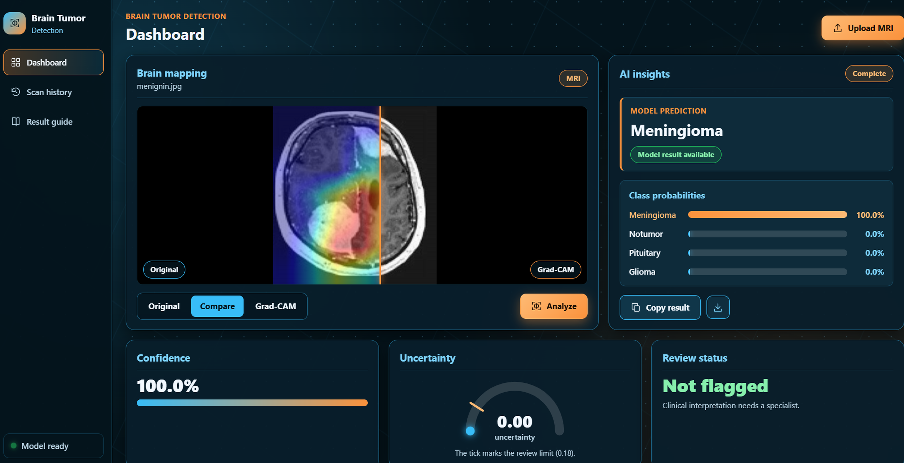
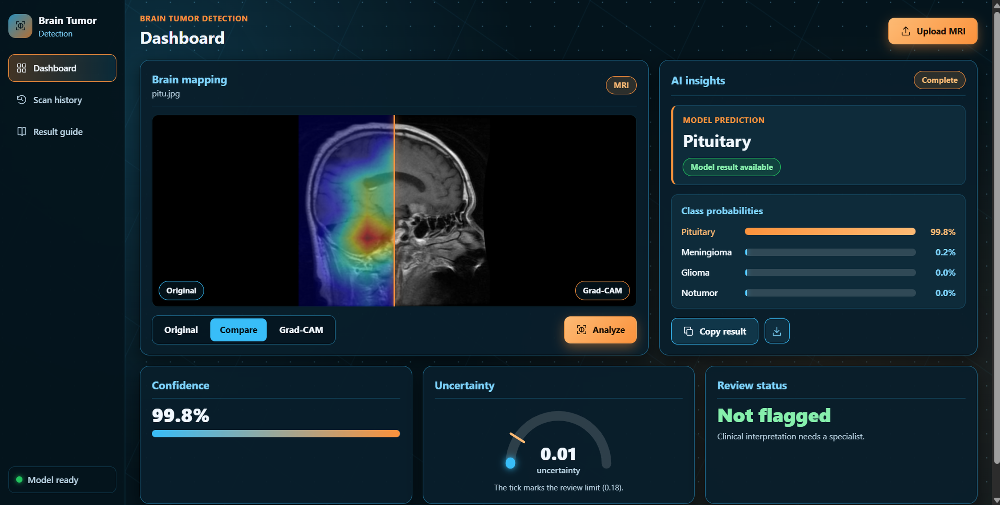

# 🧠 Brain Tumor Detection Using CNN

An AI-powered brain MRI image classification project that uses a **Convolutional Neural Network (CNN)** to classify brain MRI images into four categories: **Glioma, Meningioma, Pituitary Tumor, and No Tumor**.

The project integrates deep learning with a Flask backend and a React frontend to provide an interactive interface for MRI image uploads, predictions, confidence scores, class probabilities, and uncertainty estimation.

## 🎥 Project Demo

Watch the demonstration of the Brain Tumor Detection Using CNN application, including MRI image upload, model prediction, confidence scores, and classification results.

▶ **[Watch the Project Demo](demo/project_demo.mp4)**

## 📸 Project Screenshots

### 1. Application Dashboard


### 2. MRI Image Upload



### 3. Brain Tumor Prediction Results



## ✨ Features

- **Four-Class Classification:** Classifies brain MRI images into glioma, meningioma, pituitary tumor, and no-tumor categories.
- **CNN-Based Prediction:** Uses a trained Convolutional Neural Network for image classification.
- **Interactive Web Interface:** Upload and preview MRI images through a React frontend.
- **Prediction Confidence:** Displays the model's confidence score for its prediction.
- **Class Probabilities:** Displays the model's scores for the supported classes.
- **Uncertainty Estimation:** Uses prediction entropy and a configurable threshold to flag uncertain outputs.
- **Flask REST API:** Connects the frontend with the trained model.
- **Scan History:** Displays recent predictions during the current session.
- **Heatmap Support:** Supports visual explanation display when a heatmap is provided by the backend.
- **Responsive Design:** Provides a dashboard designed for desktop and mobile screens.

## 🛠️ Technologies Used

| Technology     | Purpose                             |
| -------------- | ----------------------------------- |
| Python         | Core programming language           |
| TensorFlow     | Deep learning framework             |
| Keras          | CNN model development and inference |
| NumPy          | Numerical operations                |
| Pillow         | Image processing                    |
| Flask          | Backend API                         |
| React          | Frontend interface                  |
| JavaScript     | Frontend functionality              |
| CSS            | User interface styling              |
| Kaggle         | Model training and experimentation  |
| Git and GitHub | Version control and project hosting |

## 🧠 Model Performance

The model achieved the following results on the test dataset.

| Evaluation Metric                | Result |
| -------------------------------- | -----: |
| Test Accuracy                    |  94.3% |
| Accepted Prediction Coverage     |  96.9% |
| Accuracy on Accepted Predictions |  96.0% |

### Classification Report

| Class      | Precision | Recall | F1-Score |
| ---------- | --------: | -----: | -------: |
| Glioma     |     99.0% |  80.6% |    88.9% |
| Meningioma |     86.4% |  97.2% |    91.5% |
| No Tumor   |     96.2% | 100.0% |    98.0% |
| Pituitary  |     97.5% |  99.0% |    98.3% |

**Note:** These are the reported test evaluation results. Accepted prediction coverage represents the proportion of predictions that pass the uncertainty filter. Accuracy on accepted predictions is calculated only for that subset. Actual performance may vary on MRI images from other sources.

## 📂 Project Structure

```text
BRAIN_TUMOR_DETECTION_CNN/
│
├── frontend/
│   ├── src/
│   │   ├── components/
│   │   │   ├── CompareViewer.jsx
│   │   │   ├── ProbabilityBars.jsx
│   │   │   └── UncertaintyGauge.jsx
│   │   ├── App.jsx
│   │   ├── App.css
│   │   └── main.jsx
│   └── package.json
│
├── training/
│
├── weights/
│   ├── brain_tumor_model.keras
│   └── class_names.json
│
├── screenshots/
│   ├── dashboard.png
│   ├── image_upload.png
│   └── prediction_result.png
│
├── demo/
│   └── project_demo.mp4
│
├── app.py
├── requirements.txt
├── start.ps1
└── README.md
```

_The structure above is illustrative. Adjust the names and paths to match your actual repository._

## ⚙️ Installation and Setup

### Prerequisites

- Python
- Node.js and npm
- Git
- A compatible trained CNN model

### Step 1: Clone the Repository

```bash
git clone YOUR_GITHUB_REPOSITORY_URL
cd BRAIN_TUMOR_DETECTION_CNN
```

Replace `YOUR_GITHUB_REPOSITORY_URL` with your actual GitHub repository URL.

### Step 2: Create a Python Virtual Environment

```bash
python -m venv venv
```

Activate it in Windows PowerShell:

```powershell
.\venv\Scripts\Activate.ps1
```

### Step 3: Install Backend Dependencies

```bash
pip install -r requirements.txt
```

### Step 4: Verify the Model Files

Ensure that the trained model and class names file are available at the paths expected by your backend.

```text
weights/
├── brain_tumor_model.keras
└── class_names.json
```

If your model is stored in another directory, update the model path in your backend configuration.

### Step 5: Start the Flask Backend

```bash
python app.py
```

Keep the backend terminal running. The frontend uses `http://127.0.0.1:5000` by default unless the `VITE_API_URL` environment variable is configured.

### Step 6: Start the React Frontend

Open another terminal:

```bash
cd frontend
npm install
npm run dev
```

Open the local development URL displayed in the terminal.

## 🔍 How It Works

1. **Image Upload:** The user selects a brain MRI image through the frontend.
2. **Image Preprocessing:** The backend prepares the image according to the trained model's input requirements.
3. **CNN Inference:** The trained CNN processes the image and generates classification scores.
4. **Prediction:** The model identifies the class with the highest score.
5. **Confidence Analysis:** The application displays the prediction confidence and available class probabilities.
6. **Uncertainty Estimation:** Entropy-based filtering can flag predictions that require additional caution.
7. **Results Display:** The frontend presents the model output and any additional information provided by the backend.

## 📊 Uncertainty Estimation

The project uses prediction entropy to estimate uncertainty in the model's output probability distribution.

A configurable threshold is used to flag predictions with higher uncertainty. This provides an additional indicator to help distinguish predictions that pass the chosen threshold from those that do not.

The uncertainty score is a model-based indicator, not a measure of clinical certainty.

## 🚀 Future Improvements

- Integrate Grad-CAM to highlight image regions that influence predictions.
- Improve recall for classes with comparatively weaker results.
- Evaluate the model on independent MRI datasets.
- Add confusion matrix and per-class performance visualizations.
- Generate downloadable prediction reports.
- Improve API validation and error handling.
- Deploy the application using an appropriate hosting platform.
- Add automated tests for image preprocessing and inference.

## 🔮 Applications

- Educational demonstrations of CNN-based image classification.
- Experimentation with medical image preprocessing and deep learning.
- Exploring uncertainty estimation in machine learning.
- Demonstrating the integration of an ML model with a web application.

## ⚠️ Disclaimer

This project is intended for educational and research purposes only. It is **not a medical diagnostic tool** and must not be used to diagnose or rule out brain tumors. Model predictions can be incorrect and must not replace evaluation by a qualified medical professional.

## 👨‍💻 Author

Developed as an Artificial Intelligence and Machine Learning project to explore deep learning, brain MRI image classification, model evaluation, uncertainty estimation, and full-stack AI application development.
