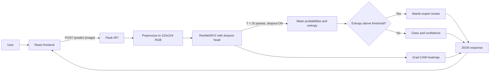
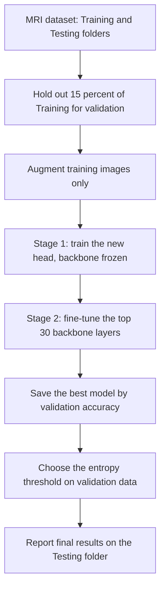

# Architecture

This page explains how the project works, from training to the web app.
(GitHub draws the diagrams below automatically.)

## 1. System overview



The model is loaded once when the Flask server starts, not on every request.

## 2. Training and evaluation flow



## 3. Model

```
Input 224 x 224 x 3 (pixel values 0-255)
  -> Rescaling to [-1, 1]
  -> ResNet50V2 backbone (ImageNet weights, BatchNorm always in inference mode)
  -> GlobalAveragePooling2D
  -> Dense 256, ReLU
  -> Dropout 0.4        (stays ON during the MC passes)
  -> Dense N, softmax   (one output per class)
```

## 4. Prediction logic (Monte Carlo Dropout)

```
for t in 1..T:  p_t = model(image, training=True)      # dropout active
p_mean       = mean(p_t)
predicted    = argmax(p_mean)
uncertainty  = entropy(p_mean) / log(N)                # scaled to 0..1
needs_review = uncertainty > threshold                 # threshold chosen on validation data
```

## 5. Why BatchNorm stays frozen

If BatchNorm ran in training mode during the MC passes, its statistics would change on every pass
and add noise that has nothing to do with dropout. The backbone is therefore always called with
`training=False`.

## 6. Code map

| Path | Role |
|---|---|
| `backend/model/build.py` | Builds the ResNet50V2 model, fine-tuning helper |
| `backend/model/mc_dropout.py` | T stochastic passes and the entropy score |
| `backend/model/gradcam.py` | Heatmap on the last convolutional map |
| `backend/app.py` | Flask API: `/predict`, `/health` |
| `training/train.py` | Two-stage training |
| `training/evaluate.py` | Metrics, accuracy vs. coverage, uncertainty plots |
| `frontend/` | React upload page and result view |
